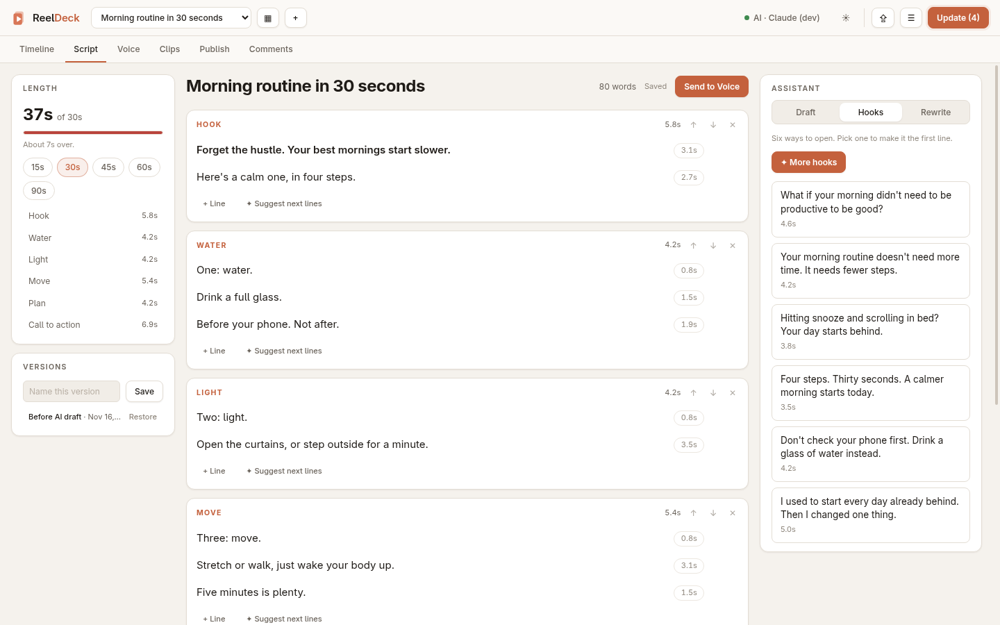
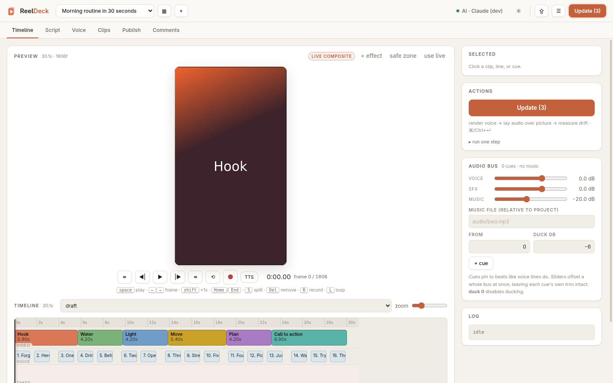
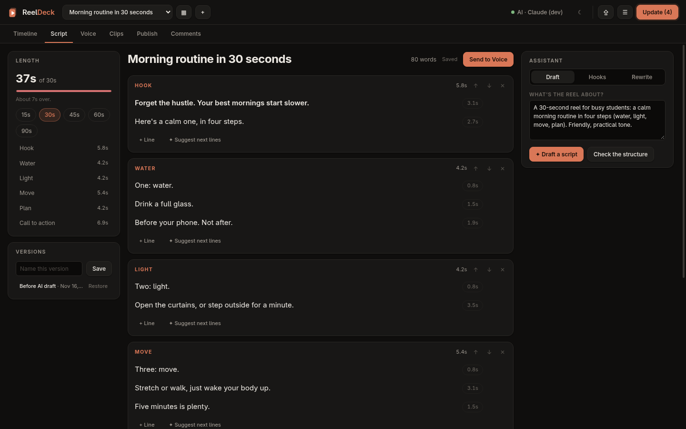
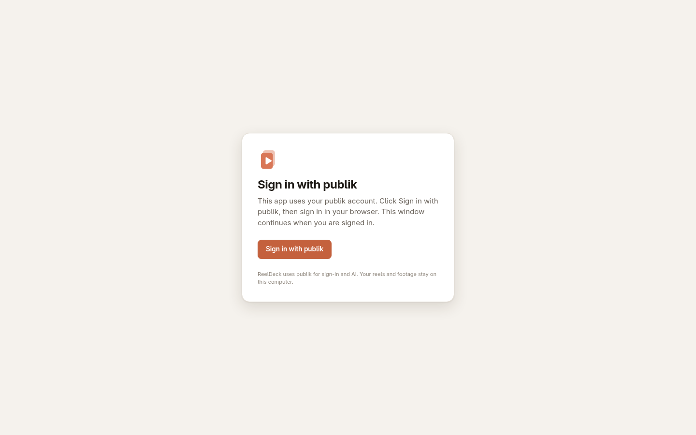
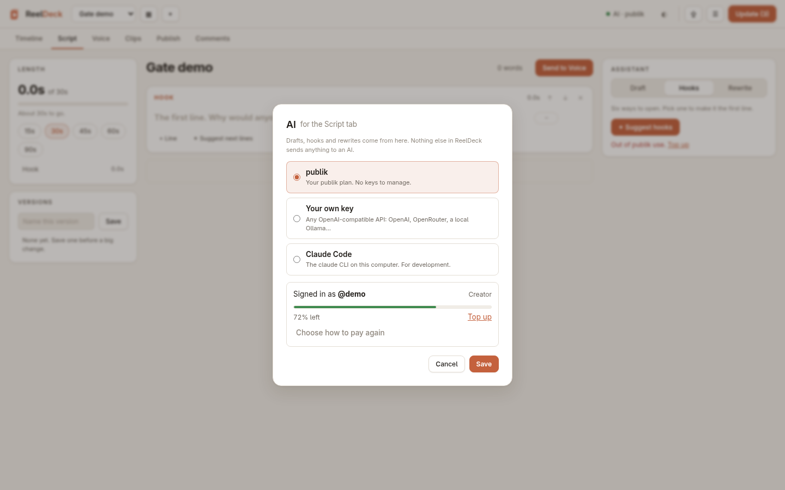

# ReelDeck

A local studio for short vertical videos. Write the script, voice it, cut it,
mix it and post it to Instagram, from one browser tab, with your footage
staying on your computer.



- **Script.** Write in beats and lines against a target length (15 to 90 s).
  Each line shows how long it takes to say. Save named versions and restore
  them. The assistant drafts a script from a one-line brief, suggests hooks,
  rewrites a line, and proposes the next lines of a beat. **Send to Voice**
  turns the script into the voiceover.
- **Voice.** Render each line with a TTS server, or record your own takes
  (also from a phone, at `/master`). Takes are cleaned up and lined up to the
  picture.
- **Timeline.** Drag, trim and reorder clips. A live composited preview,
  crossfades, sound effects and a music bed with ducking. **Update** re-renders
  only what changed.
- **Clips.** Clips the project can generate from its own templates, plus a
  library of footage you can drop in.
- **Agent.** Say what the reel needs ("tighten the cut to the voiceover",
  "make the clips the requests ask for") and it proposes concrete changes:
  voiceover lines, cuts and trims on the timeline, and new HTML clips built
  from the project's own templates. Tick the ones you want and apply; **Update**
  renders them.
- **Publish.** Exactly what Instagram will receive for each reel, and a queue
  that posts it at a time you pick. Trial reels and "also share to feed" are
  supported. Without a token it is a dry run and nothing leaves your computer.
- **Comments.** Unanswered comments across recent reels, each with a public
  reply and a DM ready to send.

Light and dark themes, and a layout that works on a phone.

| | |
|---|---|
|  |  |
|  |  |

## Quickstart

### Docker (macOS, Windows, Linux)

Install [Docker Desktop](https://www.docker.com/products/docker-desktop/)
(macOS, Windows) or Docker Engine (Linux), then:

```sh
curl -O https://raw.githubusercontent.com/cyberneel/reeldeck/main/docker-compose.yml
docker compose up -d
```

Open <http://localhost:8810>. The image is built for both `amd64` and `arm64`
(Apple Silicon, Raspberry Pi 4/5, Windows on ARM).

Without compose:

```sh
docker run -d --name reeldeck -p 127.0.0.1:8810:8810 -v reeldeck-data:/data ghcr.io/cyberneel/reeldeck:latest
```

Everything that lasts lives in the `/data` volume: your reels, the project
list, the Instagram token and AI settings. To see your reels as plain files,
mount a folder at `/data/projects` (the commented line in
`docker-compose.yml`).

On Windows, run these in PowerShell. Use `Invoke-WebRequest -OutFile docker-compose.yml <url>`
in place of `curl -O`.

### From source

You need Python 3.11+ and ffmpeg. ReelDeck has no Python dependencies.

| OS | Install ffmpeg | Run |
|---|---|---|
| macOS | `brew install ffmpeg` | `python3 server.py` |
| Windows | `winget install Gyan.FFmpeg` | `py server.py` |
| Debian / Ubuntu | `sudo apt install ffmpeg` | `python3 server.py` |
| Fedora | `sudo dnf install ffmpeg` | `python3 server.py` |
| Arch | `sudo pacman -S ffmpeg` | `python3 server.py` |

```sh
git clone https://github.com/cyberneel/reeldeck
cd reeldeck
python3 server.py        # http://localhost:8810
```

By default the server listens on localhost only, plus your Tailscale address
if Tailscale is installed. New reels go in `../reeldeck-projects`, beside the
checkout. Node.js is only needed if a project renders clips from its own
HTML templates. Running from source is tested on Linux. On Windows,
Docker is the tested route.

## AI

The Script tab's assistant and the Agent tab are the only parts of ReelDeck
that talk to an AI. Pick where they go in **AI settings** (the `AI` button,
top right):

- **publik.** Release builds open with *Sign in with publik*. Sign in, pick a
  plan, and the assistant runs on it, with no keys to manage. When the plan
  runs out, the assistant links you to top up.
- **Your own key.** Any OpenAI-compatible API: OpenAI, OpenRouter, a local
  Ollama. Kept in `~/.config/reeldeck/ai.json` (mode 600). The browser never
  sees it.
- **Claude Code.** The `claude` CLI on this computer, for development.

A build with no publik app token (a source checkout, or `REELDECK_PUBLIK=off`)
skips the sign-in screen and offers the other two.

## Instagram

Paste a Meta access token into the Publish tab once. ReelDeck exchanges it for
a Page token that doesn't expire and keeps it in
`~/.config/reeldeck/instagram.json` (mode 600). It is sent only to Meta, in a
header. Covers are served to Meta for a few minutes through a
[cloudflared](https://github.com/cloudflare/cloudflared) quick tunnel when
`cloudflared` is installed. Without it, a frame of the video is the cover.

`publish_mcp.py` exposes the same queue to an MCP client, so an agent can
draft and schedule posts that show up in the tab.

## Configuration

| Variable | Default | What it does |
|---|---|---|
| `REELDECK_PORT` | `8810` | Port to listen on |
| `REELDECK_HOST` | localhost + tailnet | Bind address. Docker sets `0.0.0.0` |
| `REELDECK_PROJECTS` | `../reeldeck-projects` | Where new reels are created |
| `REELDECK_DATA` | the checkout | Project registry and caches |
| `REELDECK_TTS_URL` | `http://127.0.0.1:7860` | TTS server for the Voice tab |
| `REELDECK_PUBLIK` | `on` | `off` skips Sign in with publik |
| `PUBLIK_API_KEY` | | Use this publik key instead of signing in |
| `DO_NOT_TRACK` | | `1` turns off publik's usage telemetry (also `PUBLIK_TELEMETRY=off`) |

From Docker, a TTS server running on the host is at
`http://host.docker.internal:7860`.

## Privacy

Reels, footage, recordings and scripts stay on your computer. Data leaves it
only when you use a feature that needs it to:

- The assistant sends the script text you're working on to the AI you chose.
- Publishing sends the reel, cover and caption to Meta.
- With publik on, the publik SDK sends usage events tagged with a random
  install id, the app version and the OS. `DO_NOT_TRACK=1` turns that off.

## Development

Each module checks itself against fakes, with no network or accounts needed:

```sh
python3 pipeline.py demo && python3 publish.py && python3 publish_mcp.py --check \
  && python3 ai.py && python3 agent.py && python3 scripts.py && python3 delivery.py && python3 test_takes.py
```

The frontend is plain ES modules with no build step. Edit and reload.

### Releases

`VERSION` holds the version, as `MAJOR.MINOR.PATCH`. To release, bump it,
commit, and push a matching tag:

```sh
echo 0.2.0 > VERSION && git commit -am "Release 0.2.0" && git tag v0.2.0 && git push --follow-tags
```

The `release` workflow then publishes `ghcr.io/cyberneel/reeldeck:0.2.0`,
`:0.2` and `:latest` for amd64 and arm64, and creates a GitHub release with
generated notes. It writes the `PUBLIK_APP_TOKEN` repository secret into the
image. Without that secret, the release builds without Sign in with publik.

## License

[MIT](LICENSE)
